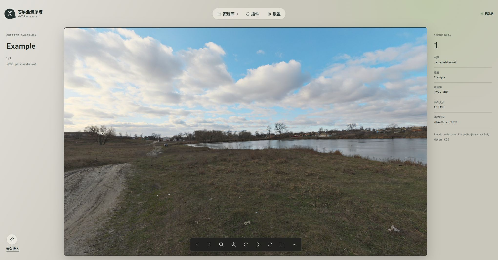

<div align="center">
  
  <h1>XinT Panorama System</h1>
  <p>Self-hosted 720° panorama viewer for embedding in websites.</p>
  <p>
    <a href="https://github.com/XinTycd/XinT-Panorama-System/actions/workflows/build.yml"></a>
    <a href="https://nodejs.org/"></a>
    <a href="https://sqlite.org/"></a>
    <a href="./LICENSE"></a>
  </p>
  <p><strong>English</strong> | <a href="./README.zh-CN.md">简体中文</a></p>
  <p><a href="https://panorama.nbxint.com/">Live demo</a> · <a href="#quick-start">Quick start</a> · <a href="#documentation">Documentation</a></p>
</div>

## Project background

Consumer 360° cameras such as the DJI Osmo 360 and Insta360 are becoming more common, making panorama capture a manageable task for individual creators and small teams. For property listings, venue introductions, tourism guides, and construction records, panorama content often needs to end up on a website where visitors can open it directly. XinT Panorama System provides a self-hosted 720° panorama viewer that embeds in an existing website through an iframe or JavaScript. It also includes a console for managing panorama resources, configuring the viewer, and debugging embeds, so developers can bring captured content into their own applications.

## Embed in a website

### With the embed script

Put the script in a page with a dedicated, empty container. Replace the sample host and panorama number with your service address and gallery item.

```html
<div id="xint-panorama"></div>
<script
  src="https://panorama.example/embed.js"
  data-target="xint-panorama"
  data-panorama-no="1"
></script>
```

The script creates a responsive iframe in the container and clears that container first. Use a dedicated element for the viewer.

### With an iframe

```html
<iframe
  src="https://panorama.example/widget?panoramaNo=1"
  title="Panorama viewer"
  loading="lazy"
  allowfullscreen
  style="display:block; width:100%; aspect-ratio:16/9; border:0;"
></iframe>
```

Import an image into the gallery first, then embed it by its panorama number. See the [embedding guide](./docs/EMBEDDING.md) for supported parameters, host requirements, and image handling.

The iframe keeps viewer scripts and styles separate from the host page. Public gallery previews use a metadata-free, lossless derivative that preserves decoded pixels and source dimensions; the stored source remains in the selected storage backend. Upload transcoding is a separate storage setting. Displayed detail still depends on the browser, device, and available texture size.


## Quick start

Requires Node.js 24 or later. To run the API and embeddable viewer without the console:

```bash
git clone https://github.com/XinTycd/XinT-Panorama-System.git
cd XinT-Panorama-System
npm ci
npm run start:backend
```

The API, widget, embed script, and viewer assets are served from port 7210 by default. The optional management console is served at port 7211 when running `npm start`, which starts both services. See the [deployment guide](./docs/DEPLOYMENT.md) (Chinese) for reverse proxy and storage setup.

## Management console

The console manages panorama images, gallery groups, project scenes, and hotspots. It also provides image preview and embed debugging. A widget embed displays one panorama rather than a whole project.

The project workspace is a built-in console plugin and is disabled by default. Use the Enable and Disable buttons in the Plugins drawer to show or hide project and scene controls. Its state and all console preferences except the language choice are saved in the server's local `console-settings.json` file.



Panorama: [Rural Landscape](https://polyhaven.com/a/rural_landscape) by Sergej Majboroda, Poly Haven ([CC0](https://polyhaven.com/license)).

Gallery images can be uploaded or registered by URL, grouped and filtered, and browsed eight per page. Project scenes and hotspots can be imported or exported as project JSON.

The Embedding drawer generates copyable iframe and JavaScript snippets for a selected server panorama, with full, compact, and no-toolbar presets. The console language picker is inside Settings.

## Configuration

Choose the viewer engine with `viewer.engine` in `config.json`: `psv` is the default; `legacy` selects the simplified original spherical viewer. The same setting is available in the local console.

```json
{ "viewer": { "engine": "psv" } }
```

## Image storage

| Location | Image content | Availability |
| --- | --- | --- |
| Browser | IndexedDB | This browser origin only; unavailable to standalone embeds |
| Server files | Image files or Base64 | Served by the XinT instance |
| SQLite | Base64 | Served by the XinT instance |
| Turso | Base64 | Requires a configured database URL and token |

Gallery and project metadata remain in local SQLite. Storage mode and transcoding settings apply to new uploads; configure them from the console on the machine running the backend.

## Development

```bash
npm test
npm run check:config
npm run build:vendor
```

Development requires Node.js 24. `npm run build:vendor` creates the local viewer assets; startup also builds them when needed.

## Documentation

- [Documentation index](./docs/README.md)
- [Deployment](./docs/DEPLOYMENT.md) (Chinese)
- [API reference](./docs/API.md) (Chinese)
- [Embedding guide](./docs/EMBEDDING.md) (Chinese)
- [v0.2.5 release notes](./docs/releases/v0.2.5.md)
- [v0.2.4 release notes](./docs/releases/v0.2.4.md)
- [Changelog](./CHANGELOG.md)

## Contributing

Read the [contribution guide](./CONTRIBUTING.md) (Chinese) and use [GitHub Issues](https://github.com/XinTycd/XinT-Panorama-System/issues) to report bugs or suggest changes.

## License

Licensed under the [Apache License 2.0](./LICENSE); third-party component terms are listed in [THIRD_PARTY_NOTICES.md](./THIRD_PARTY_NOTICES.md). See [SECURITY.md](./SECURITY.md) (Chinese) to report a security issue.
