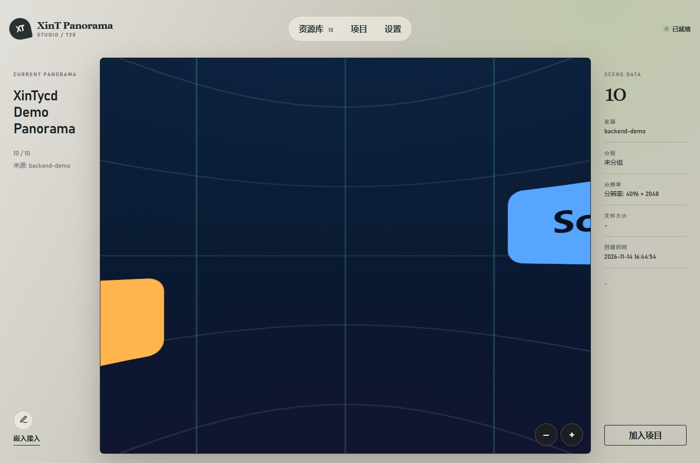

# XinT Panorama System

[简体中文](README.zh-CN.md) | **English**

A self-hosted system for organizing, browsing, and embedding 360° panorama resources.

[Quick start](#quick-start) · [Features](#features) · [Configuration](#configuration) · [Documentation](#documentation) · [Contributing](CONTRIBUTING.md)

## Project background

XinT Panorama System brings panorama images, project and scene references, and embeddable previews into one self-hosted workflow. It started from the practical overhead of keeping panorama files organized while maintaining consistent references between galleries, project scenes, and external pages.

This release updates the console and processing workflow while moving metadata storage to SQLite to simplify local deployment. The default viewer is a standard spherical panorama renderer, with drag navigation and zoom controls.



*The preview uses the built-in demo panorama and synthetic project data.*

## Quick start

Requirements: Node.js 24 or newer and npm.

```bash
npm ci
npm start
```

Open the console at <http://127.0.0.1:7211>. The API listens at <http://127.0.0.1:7210>. To validate configuration without starting the servers, run `npm run check:config`.

For Docker Compose deployment, see [DEPLOYMENT.md](DEPLOYMENT.md#docker-compose).

## Features

- Browse panorama images in a gallery, organize them into groups, and filter locally with eight items per page.
- Create projects and scenes, place hotspots, and reference gallery panoramas in scene workflows.
- Embed a panorama viewer using a script tag or a standalone widget URL.
- Choose among browser IndexedDB, local files, local SQLite, and Turso SQLite for newly saved image data; metadata remains in the local SQLite database.
- Preserve the source image or transcode uploads to JPEG, PNG, or WebP with a configurable quality setting where applicable.
- Back up and restore the SQLite database and server-side media with the included scripts.

## Viewer

This release uses the simplified spherical renderer. It supports drag navigation and zoom in/out controls. The earlier multi-projection previews and comparison view are not part of this release.

## Configuration

Edit `config.json` before starting the service. The default configuration uses SQLite and local storage:

```json
{
  "modes": ["database", "external", "upload"],
  "viewer": { "engine": "legacy" },
  "database": {
    "driver": "sqlite",
    "storageDir": "backend/storage"
  },
  "server": {
    "backend": { "host": "127.0.0.1", "port": 7210 },
    "frontend": { "host": "127.0.0.1", "port": 7211 }
  }
}
```

The viewer setting is fixed to `legacy` in this release. `PANORAMA_CONFIG` selects another config file. `PANORAMA_STORAGE_DIR`, `PANORAMA_HOST`, `PANORAMA_PORT`, `FRONTEND_HOST`, and `FRONTEND_PORT` can override storage and listen addresses. `PANORAMA_APP_MODES` accepts `database`, `external`, and `upload` as a comma-separated list. MySQL is not supported; legacy JSON gallery data is migrated to SQLite on first startup when applicable.

## Image storage

Gallery, project, scene, and settings metadata are stored in the local `panorama.sqlite` database under the configured storage directory. The image storage setting applies to newly saved images:

| Image location | Image data | Notes |
| --- | --- | --- |
| Browser | IndexedDB | Readable only in the original browser and site origin; not available to embedded widgets. |
| Local server | Files under `uploads/`, or Base64 under `encoded-images/` | Supports original bytes or transcoding. |
| Local SQLite | Base64 in `panorama.sqlite` | Choose Base64 or transcoding; original-file mode is not available. |
| Turso SQLite | Base64 in the configured Turso database | Choose Base64 or transcoding; account credentials and connectivity must be configured by the operator. |

SQLite image modes use Base64 data, optionally transcoded first. Transcoding can change the stored source copy; this system does not promise to preserve the uploaded byte stream separately. Cloud service capacity and cost depend on the operator's Turso plan.

## Development

```bash
npm test
npm run check:config
```

Tests use temporary storage and synthetic fixtures. To run the application locally, use `npm start`. Runtime data is written under the configured storage directory; keep that directory out of source control and include it in operator-managed backups.

## Documentation

- [Deployment and operations](DEPLOYMENT.md)
- [API reference](docs/API.md)
- [Embedding guide](docs/EMBEDDING.md)
- [Release notes](docs/releases/v0.2.0.md)
- [Simplified Chinese README](README.zh-CN.md)

## Contributing and security

Bug reports and contributions are welcome through the repository's [issue tracker](https://github.com/XinTycd/XinT-Panorama-System/issues) and [contribution guide](CONTRIBUTING.md). For security-sensitive reports, follow [SECURITY.md](SECURITY.md). Before publishing a fork or release, review the staged file list and confirm that it contains no runtime database, uploaded media, credentials, or backups.

## License

The project is distributed under the [Apache License 2.0](LICENSE). The bundled Three.js browser build retains its upstream license notice; see [third-party notices](THIRD_PARTY_NOTICES.md).
