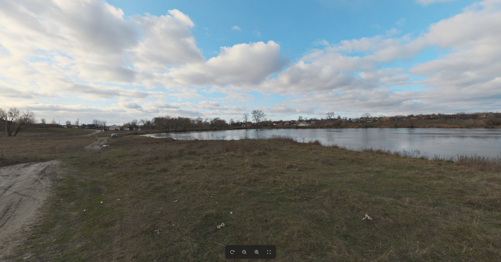

<div align="center">
  
  <h1>XinT Panorama System</h1>
  <p>可自行部署、用于嵌入现有网站的 720° 全景查看器。</p>
  <p>
    <a href="https://github.com/XinTycd/XinT-Panorama-System/actions/workflows/build.yml"></a>
    <a href="https://nodejs.org/"></a>
    <a href="https://sqlite.org/"></a>
    <a href="./LICENSE"></a>
  </p>
  <p><a href="./README.md">English</a> | <strong>简体中文</strong></p>
  <p><a href="https://panorama.nbxint.com/">在线演示</a> · <a href="#快速开始">快速开始</a> · <a href="#文档">文档</a></p>
</div>

## 项目背景

DJI Osmo 360、Insta360 这类消费级全景相机越来越常见，个人创作者和小团队拍全景不再是大工程。房产展示、场地介绍、旅游导览、施工记录等场景，最后往往都要把全景内容放到网站上，让访客直接点开看。XinT Panorama System 提供的是一套可自行部署的 720° 全景查看器，通过 iframe 或 JavaScript 嵌进现有网站。它还配了一个控制台，用来管理全景资源、配置查看器、调试嵌入效果，开发者可以把拍好的内容接进自己的业务里。

## 嵌入网站

### 使用嵌入脚本

在网页中放置一个专用的空容器，再加入脚本。将示例域名和全景编号改为你的服务地址及图库资源编号。

```html
<div id="xint-panorama"></div>
<script
  src="https://panorama.example/embed.js"
  data-target="xint-panorama"
  data-panorama-no="1"
></script>
```

脚本会在容器中创建自适应尺寸的 iframe，并先清空容器内容。请使用专用元素挂载查看器。

### 直接使用 iframe

```html
<iframe
  src="https://panorama.example/widget?panoramaNo=1"
  title="全景查看器"
  loading="lazy"
  allowfullscreen
  style="display:block; width:100%; aspect-ratio:16/9; border:0;"
></iframe>
```

请先将图片导入图库，再按全景编号嵌入。支持参数、宿主要求和图片处理方式见[嵌入说明](./docs/EMBEDDING.md)。

iframe 将查看器脚本与样式隔离在独立页面中。Photo Sphere Viewer 先加载较小的预览图，在视口增大或访客放大画面时提升清晰度。视图需要更高细节且设备支持时，可加载全尺寸无损派生图。存储的源文件始终保留在服务端。



## 快速开始

需要 Node.js 24 或更高版本。只运行 API 和嵌入查看器时：

```bash
git clone https://github.com/XinTycd/XinT-Panorama-System.git
cd XinT-Panorama-System
npm ci
npm run start:backend
```

API、widget、嵌入脚本和查看器资源默认由 7210 端口提供。管理控制台是可选组件；运行 `npm start` 会同时启动后端和 7211 端口的控制台。反向代理和存储设置见[部署指南](./docs/DEPLOYMENT.md)。

## 管理控制台

控制台用于管理全景图片、图库分组、项目场景和热点，也可预览图片并调试嵌入设置。嵌入 widget 展示单张全景图片，不会展示整个项目。

项目工作区是默认禁用的内置插件。在“插件”抽屉中使用“启用”和“禁用”按钮，可显示或隐藏项目和场景入口。插件状态及语言偏好之外的控制台偏好保存在服务端的 `console-settings.json`。


截图全景图：[Rural Landscape](https://polyhaven.com/a/rural_landscape)，作者 Sergej Majboroda，Poly Haven（[CC0](https://polyhaven.com/license)）。

图库支持上传或登记图片 URL、分组与筛选，每页浏览 8 项。项目场景和热点可通过项目 JSON 导入或导出。

嵌入接入抽屉会为选中的服务端全景图生成可复制的 iframe 和 JavaScript 代码，并提供完整、精简和隐藏三种控件预设。控制台语言入口位于“设置”抽屉内。

## 配置

在 `config.json` 的 `viewer.engine` 中选择查看器：默认值 `psv` 使用 Photo Sphere Viewer，`legacy` 使用简化的原球面查看器。本地控制台也提供相同设置。

```json
{ "viewer": { "engine": "psv" } }
```

## 图片存储

| 位置 | 图片内容 | 可用范围 |
| --- | --- | --- |
| 浏览器 | IndexedDB | 仅限当前浏览器来源；独立嵌入无法读取 |
| 服务端文件 | 图片文件或 Base64 | 由当前 XinT 服务提供 |
| SQLite | Base64 | 由当前 XinT 服务提供 |
| Turso | Base64 | 需要配置数据库地址和令牌 |

图库和项目元数据保存在本地 SQLite。存储位置和转码设置适用于新上传图片，需在运行后端的电脑上通过控制台配置。

## 开发

```bash
npm test
npm run check:config
npm run build:vendor
```

开发环境需要 Node.js 24。`npm run build:vendor` 会构建本地查看器资源；启动时也会在缺少资源时构建。

## 文档

- [文档索引](./docs/README.md)
- [部署指南](./docs/DEPLOYMENT.md)
- [API 参考](./docs/API.md)
- [嵌入说明](./docs/EMBEDDING.md)
- [变更记录](./CHANGELOG.md)

## 贡献

请阅读[贡献指南](./CONTRIBUTING.md)，并通过 [GitHub Issues](https://github.com/XinTycd/XinT-Panorama-System/issues) 报告问题或提出改进建议。

## 许可

本项目采用 [Apache License 2.0](./LICENSE)；第三方组件许可见 [THIRD_PARTY_NOTICES.md](./THIRD_PARTY_NOTICES.md)。安全问题报告方式见[安全政策](./SECURITY.md)。
