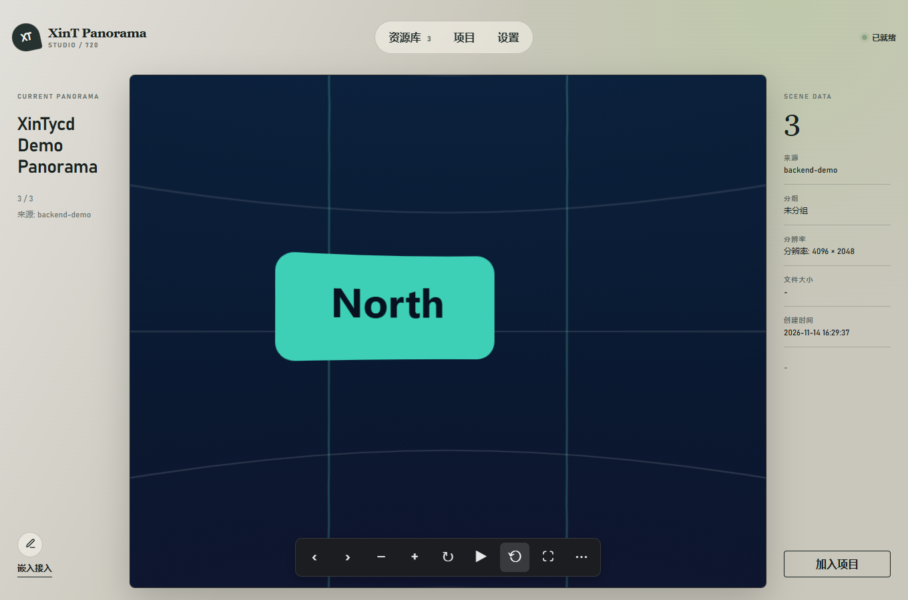

# XinT Panorama System

[English](./README.md) | **简体中文**

可自行部署的 720° 全景资源管理与浏览系统，支持项目场景、热点和网页嵌入。

[](https://nodejs.org/)
[](https://sqlite.org/)
[](./LICENSE)

## 项目背景

XinT Panorama 将全景文件管理、场景组织和网站展示放在一处。用户可在自己的服务上管理全景资源，将它们编排为项目场景，并用于项目页面或现有网站。



## 功能

- 上传全景文件或登记图片 URL；按分组管理和筛选图库，每页浏览 8 项。
- 组织项目场景与热点，导入或导出项目 JSON，并创建发布快照。
- 默认使用 Photo Sphere Viewer（PSV）浏览全景，也可选择简化的原球面查看器以兼容旧用法。
- 在控制台设置中选择要显示的查看工具。
- 将图片保存到浏览器 IndexedDB、服务端文件、SQLite 或 Turso；服务端和浏览器存储也支持 JPEG、PNG、WebP 转码。
- 通过脚本或 iframe 将全景嵌入网站。
- 备份并恢复数据库及本地保存的媒体文件。

## 快速开始

需要 Node.js 24 或更高版本。

```bash
git clone https://github.com/XinTycd/XinT-Panorama-System.git
cd XinT-Panorama-System
npm ci
npm start
```

打开控制台 <http://127.0.0.1:7211>；API 默认监听 <http://127.0.0.1:7210>。Docker、配置、备份与恢复说明见[部署指南](./docs/DEPLOYMENT.md)。

## 配置

在 `config.json` 中选择查看器引擎：`psv` 为默认值，`legacy` 为简化的原球面查看器。

```json
{ "viewer": { "engine": "psv" } }
```

也可在本地控制台设置中选择。其他配置说明见[部署指南](./docs/DEPLOYMENT.md)。

## 网页嵌入

```html
<div id="panorama"></div>
<script
  src="https://your-host.example/embed.js"
  data-target="panorama"
  data-panorama-no="1"
></script>
```

脚本属性和 iframe 选项见[嵌入说明](./docs/EMBEDDING.md)。为避免混合内容拦截，宿主网页和 XinT 服务均应使用 HTTPS。

## 图片存储

| 位置 | 图片内容 | 可用范围 |
| --- | --- | --- |
| 浏览器 | IndexedDB | 仅限当前浏览器来源；独立嵌入无法读取 |
| 服务端文件 | 图片文件或 Base64 | 由当前 XinT 服务提供 |
| SQLite | Base64 | 由当前 XinT 服务提供 |
| Turso | Base64 | 需要配置数据库地址和令牌 |

图库和项目元数据保存在本地 SQLite。图片存储设置需在运行后端的电脑上通过本地控制台更改。配置方法见[部署指南](./docs/DEPLOYMENT.md)。

## 开发

```bash
npm test
npm run check:config
npm run build:vendor
```

开发环境需要 Node.js 24。`npm run build:vendor` 用于构建本地查看器资源；应用启动时也会在需要时生成这些资源。

## 文档

- [文档索引](./docs/README.md)
- [部署指南](./docs/DEPLOYMENT.md)
- [API 参考](./docs/API.md)
- [嵌入说明](./docs/EMBEDDING.md)
- [变更记录](./CHANGELOG.md)，包括 [v0.2.2 发布说明](./docs/releases/v0.2.2-zh-CN.md)

## 贡献

请阅读[贡献指南](./CONTRIBUTING.md)并通过 [GitHub Issues](https://github.com/XinTycd/XinT-Panorama-System/issues) 报告问题或提出改进建议。

## 许可

本项目采用 [Apache License 2.0](./LICENSE)；第三方组件许可见 [THIRD_PARTY_NOTICES.md](./THIRD_PARTY_NOTICES.md)。安全问题报告方式见[安全政策](./SECURITY.md)。
